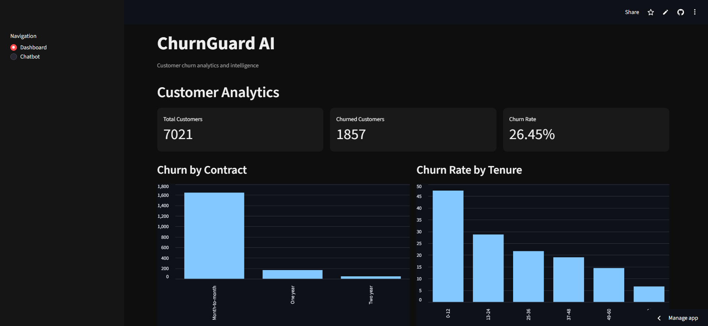
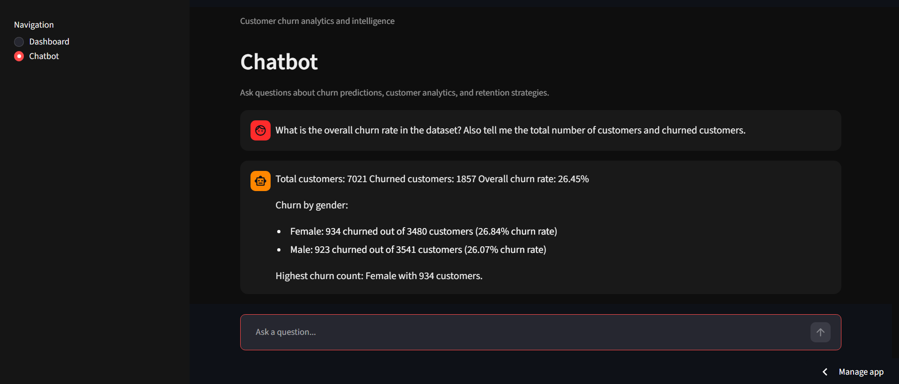
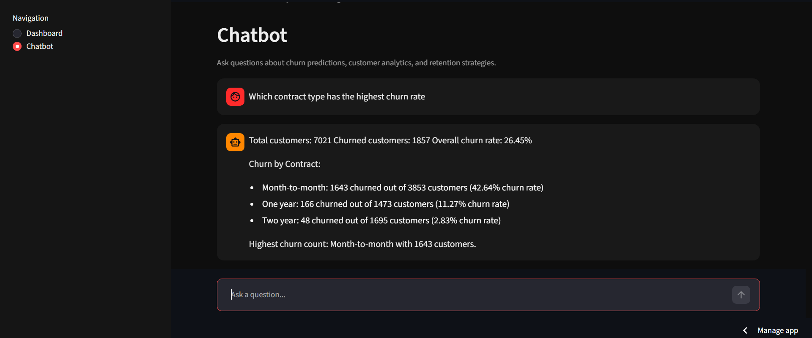
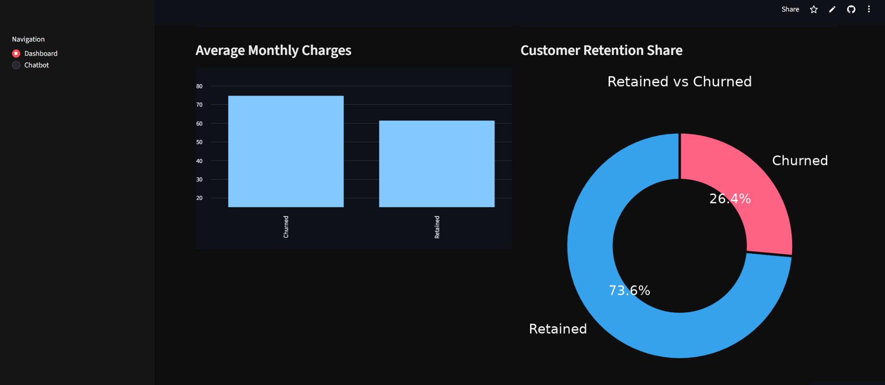
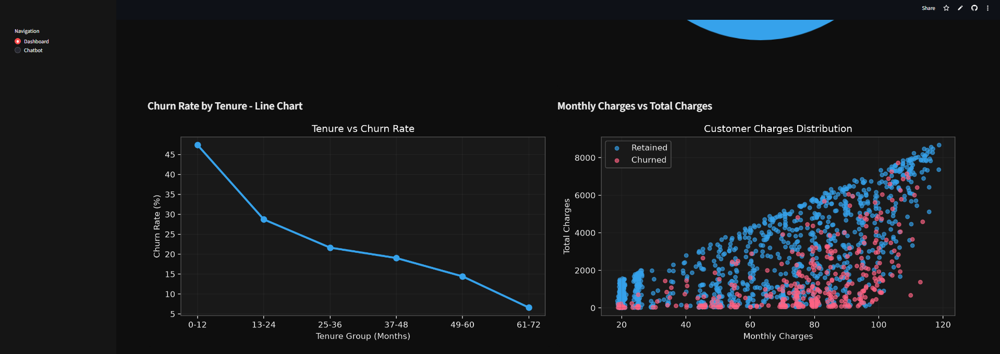
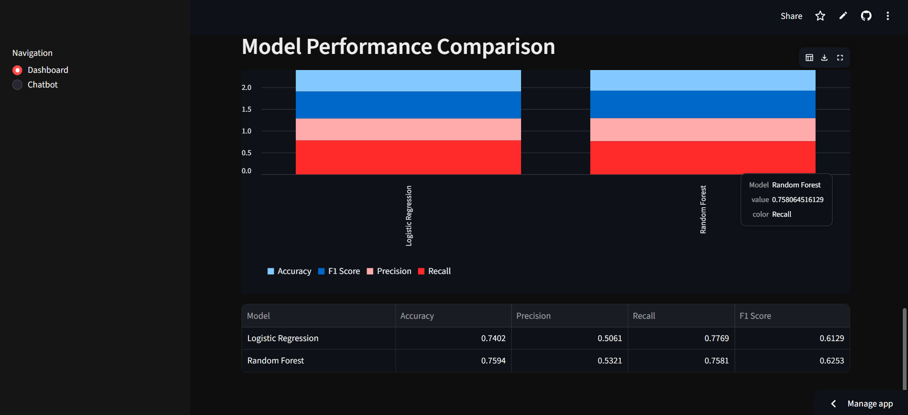
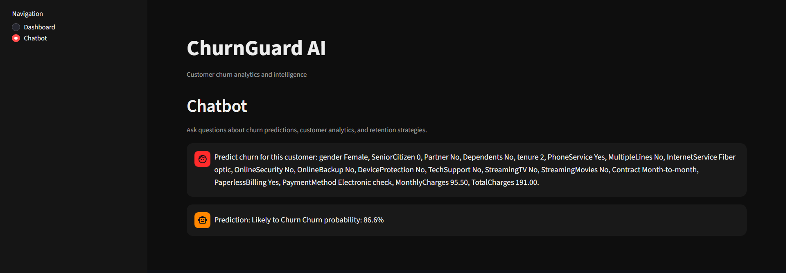
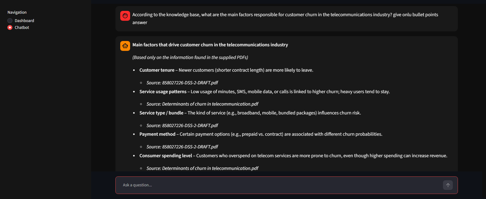
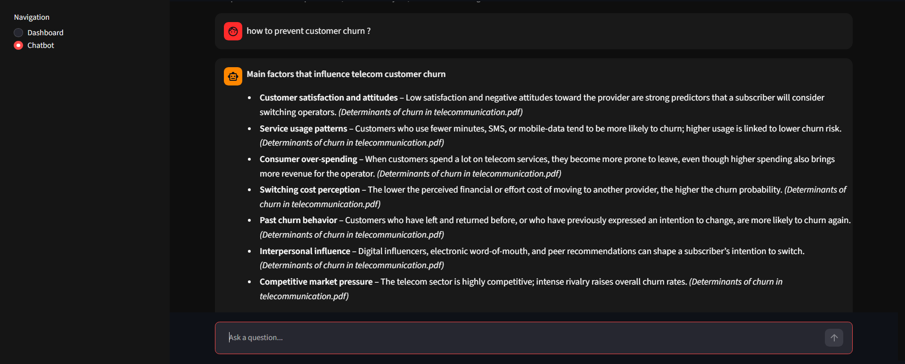

# ChurnGuard AI 
### AI-Powered Telecom Customer Churn Prediction & Retention Assistant

ChurnGuard AI is a Machine Learning and Generative AI project that helps analyze telecom customer churn, identify customers at risk of leaving, and explore customer retention strategies.

The project combines an interactive **Streamlit dashboard**, a trained **Machine Learning model**, a document-based **Retrieval-Augmented Generation (RAG)** system, and an **AI agent** to provide data-driven insights through a chatbot.

## Dashboard & Customer Analytics

The interactive dashboard provides an overview of customer churn using KPIs, visualizations, customer analytics, and machine learning model evaluation.

### Key Features
- Customer and churn summary through KPIs
- Customer churn analytics and segment-level insights
- Interactive bar, donut, line, and scatter charts
- Natural-language questions for exploring analytics
- Machine Learning model comparison
- Model evaluation visualizations

### Dashboard Screenshots

**1. KPI Dashboard**



**2. Customer Analytics**



**3. Customer Churn Insights**



**4. Bar and Donut Charts**



**5. Line and Scatter Charts**



**6. Machine Learning Model Comparison**



## AI Chatbot

ChurnGuard AI includes a chatbot that allows users to ask questions about customer churn, analytics, machine learning predictions, and customer retention knowledge.

The chatbot combines three main capabilities:

### 1. Machine Learning — Churn Prediction

A trained classification model predicts whether a telecom customer is likely to churn based on customer information, such as tenure, contract type, monthly charges, and subscribed services.

**How it helps:**
- Identifies potentially high-risk customers
- Supports customer retention planning
- Helps businesses prioritize customers who may need attention



### 2. Retrieval-Augmented Generation (RAG)

Retrieval-Augmented Generation (RAG) allows the chatbot to retrieve relevant information from a knowledge base before generating an answer.

The project uses telecom churn and customer retention documents as its knowledge base.

**RAG workflow:**
1. Load and process PDF documents.
2. Convert document text into smaller chunks.
3. Generate embeddings using a sentence-transformer model.
4. Store and search document embeddings using FAISS.
5. Retrieve relevant text for a user's question.
6. Use the retrieved context to generate an answer with a Large Language Model (LLM).

This helps the chatbot answer questions using information retrieved from the project's documents rather than relying only on the LLM's general knowledge.

**RAG Example 1**



**RAG Example 2**



### 3. AI Agent

The AI agent connects different project capabilities through tools, helping it respond to business-related questions using analytics, predictions, and retrieved knowledge.

The agent can use tools to:

- `analyze_customers()` — Analyze customer churn rates and customer segments.
- `predict_churn()` — Use the trained Machine Learning model to predict churn risk.
- `search_retention_knowledge()` — Search the RAG knowledge base for relevant information.

By connecting these tools, the agent can provide more useful responses to questions about customer churn and retention.

## Machine Learning Workflow

The Machine Learning component follows a typical classification workflow:

1. Load the telecom customer churn dataset.
2. Prepare customer features and the target variable.
3. Process the data for model training.
4. Train and compare classification models.
5. Evaluate model performance.
6. Save the selected model and required preprocessing objects.
7. Use the trained model for churn-risk predictions in the application.

Model performance is explored through model comparison and evaluation visualizations.

## Tech Stack

| Category | Technologies |
|---|---|
| Programming Language | Python |
| Data Analysis | Pandas, NumPy |
| Visualization | Matplotlib, Seaborn, Plotly |
| Machine Learning | Scikit-learn |
| Imbalanced Data Handling | Imbalanced-learn |
| Generative AI | Groq API |
| Embeddings | Sentence Transformers |
| Vector Search | FAISS |
| RAG Framework | LangChain |
| PDF Processing | PyPDF |
| Frontend & Dashboard | Streamlit |
| Model Storage | Joblib |

## Project Structure

```text
ChurnGuard-AI/
│
├── app.py
├── requirements.txt
├── README.md
├── .gitignore
│
├── data/
│   └── WA_Fn-UseC_-Telco-Customer-Churn.csv
│
├── knowledge_base/
│   ├── 858027226-DSS-2-DRAFT.pdf
│   ├── A comprehensive survey on customer churn analysis studies.pdf
│   ├── Determinants of churn in telecommunication.pdf
│   ├── retention and churn prediction.pdf
│   ├── chunks.pkl
│   └── faiss_index.bin
│
├── models/
│   ├── churn_model.pkl
│   ├── columns.pkl
│   ├── scaler.pkl
│   └── model_comparison.csv
│
├── screenshots/
│   ├── Kpi_dashboard.png
│   ├── analytics_que.png
│   ├── insight_que.png
│   ├── bar_donut.png
│   ├── line_scatter.png
│   ├── model_compare.png
│   ├── ml_ques.png
│   ├── rag_ques1.png
│   └── rag_que2.png
│
└── src/
    ├── agent.py
    ├── analytics.py
    ├── data_processing.py
    ├── ml_model.py
    ├── rag.py
    └── rag_search.py
```

## How to Run Locally

### 1.Clone the Repository

```bash
git clone https://github.com/Ishankhan07/ChurnGuard-Ai.git
cd ChurnGuard-Ai
```

### 2. Install Dependencies

```bash
pip install -r requirements.txt
```

### 3. Configure the API Key

Create a `.env` file in the project root and add your own Groq API key:

```text
GROQ_API_KEY=your_groq_api_key
```

Keep this file private. Never upload any API key to GitHub.

### 4. Run the Application

```bash
streamlit run app.py
```

Open the local URL displayed in your terminal to use the application.

## Project Objective

ChurnGuard AI demonstrates how Machine Learning, customer analytics, RAG, and AI-agent tools can work together in a practical telecom customer-retention use case.

The goal is to turn customer data and domain knowledge into actionable insights that can support better customer-retention decisions.

---

**Built with Python, Machine Learning, RAG, and Streamlit.
Mohammad Ishan Khan**
